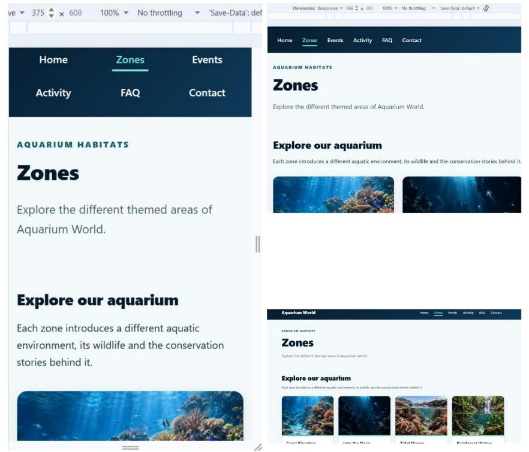

# Aquarium World

An academic web application for a fictional aquarium, built with Node.js, Express, EJS and SQLite.

The project combines a responsive visitor website with database-driven content, asynchronous search, event filtering and a contact form.

## Visual preview



Mobile screenshot recorded in the assessment documentation.

## Main features

- Aquarium zones and exhibit information loaded from SQLite.
- Zone and event detail pages.
- Search across zones, exhibits and events without a full page reload.
- Event filtering by year and category using a JSON API.
- Contact form with server-side validation and database storage.
- Interactive activity with keyboard support.
- FAQ, privacy information and a custom 404 page.
- Responsive layouts for mobile, tablet and desktop screens.

## Tools and technologies

- HTML and CSS.
- JavaScript and ES modules.
- Node.js and Express.
- EJS templates.
- SQLite.
- Fetch API and AJAX.
- Git and GitHub.

## Application structure

| Location | Purpose |
|---|---|
| `index.mjs` | Express configuration and application entry point |
| `routes/` | Page routes and API handlers |
| `views/` | EJS pages and shared partials |
| `public/` | Stylesheets, browser JavaScript and images |
| `database/` | SQLite database, connection and setup scripts |
| `package.json` | Dependencies and project configuration |

Express handles incoming requests, queries SQLite where needed and renders EJS pages. Browser JavaScript requests JSON from the search and events APIs and updates the page.

## Selected implementation details

### Database-driven content

Zones, exhibits and events are retrieved from related database tables rather than repeated as static page content.

### Asynchronous interactions

Search and event filters provide loading, empty-result and error states. Event filtering includes a request-order guard to prevent an older response from replacing newer results.

### Validation and data handling

The contact form uses server-side validation and parameterised inserts. Search and event queries use parameters, while dynamic browser results are constructed with DOM methods and textContent.

These measures demonstrate selected defensive practices; they do not constitute a complete security audit.

## Accessibility and responsive design

The implementation includes semantic headings, labelled form fields, visible focus styles and keyboard interaction.

The assessment documentation records checks at viewport widths of 375, 768 and 1440 pixels.

## Testing evidence

The submitted project documentation records:

- A fresh dependency installation and successful local startup.
- Functional checks of navigation, contact submission, search, event filters and the activity.
- Checks in Chrome, Edge and Firefox.
- Responsive and keyboard-navigation checks.
- W3C HTML validation with no reported errors or warnings on the documented pages.

During portfolio preparation, additional checks covered JavaScript syntax, SQLite integrity and database-referenced image paths in the supplied submission copy.

A fresh browser-based test of the current GitHub version has not yet been completed as part of this portfolio review.

## Running locally

Node.js and npm are required. The assessment was tested locally with Node.js 24.18.0.

Download or clone the repository, then open a terminal in the folder containing `package.json`.

Install dependencies and start the application:

```bash
npm install
node index.mjs
```

On Windows PowerShell, if execution policy blocks `npm.ps1`, use:

```powershell
npm.cmd install
node index.mjs
```

Open:

http://localhost:5000

Keep the supplied folder structure intact and run the commands from the project root.

Contact submissions modify the SQLite database. Use a copy of the project for testing.

## Portfolio presentation

This project demonstrates how I connect a relational database, server-side logic and a browser interface.

It complements my analytics projects by showing practical experience with data retrieval, validation, APIs and application development.

The application requires a Node.js server. GitHub Pages can host its portfolio case study, but cannot run the Express and SQLite backend.

## My contribution

I developed the application as part of my university Web Technologies assessment, including the database-driven pages, browser interactions, responsive styling and supporting testing documentation.

The original development history is retained in this repository.

## Current scope and limitations

- Aquarium World is an academic demonstration for a fictional organisation.
- A live hosted application is not currently linked.
- Database setup and public-release data will be reviewed before a live deployment.
- Accessibility checks cover documented behaviours and do not establish full accessibility conformance.

## AI assistance

AI tools supported planning, technical explanations, troubleshooting, visual review and documentation. I implemented and tested the assessment project, with the scope of later portfolio checks stated separately.

## Author

Ana Tinelli

- [GitHub](https://github.com/Ana-Tinelli)
- [LinkedIn](https://www.linkedin.com/in/ana-paula-tinelli-a90706131/)
